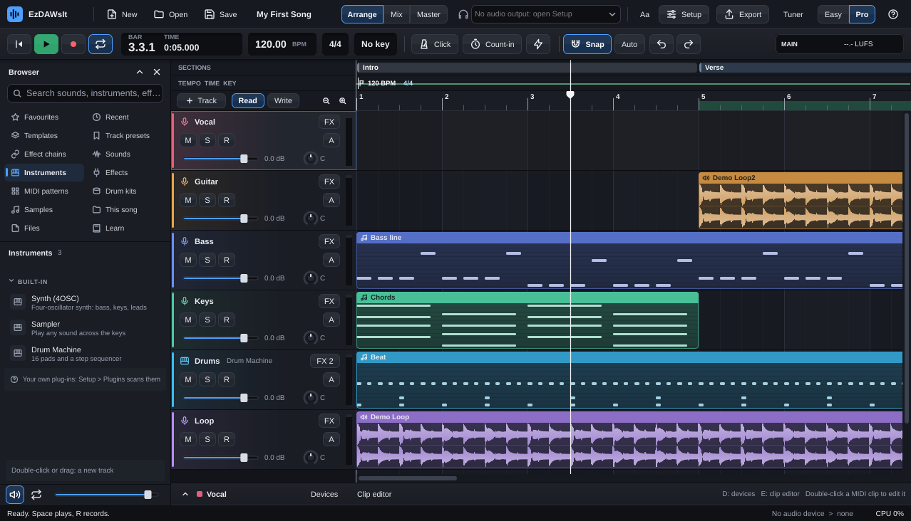
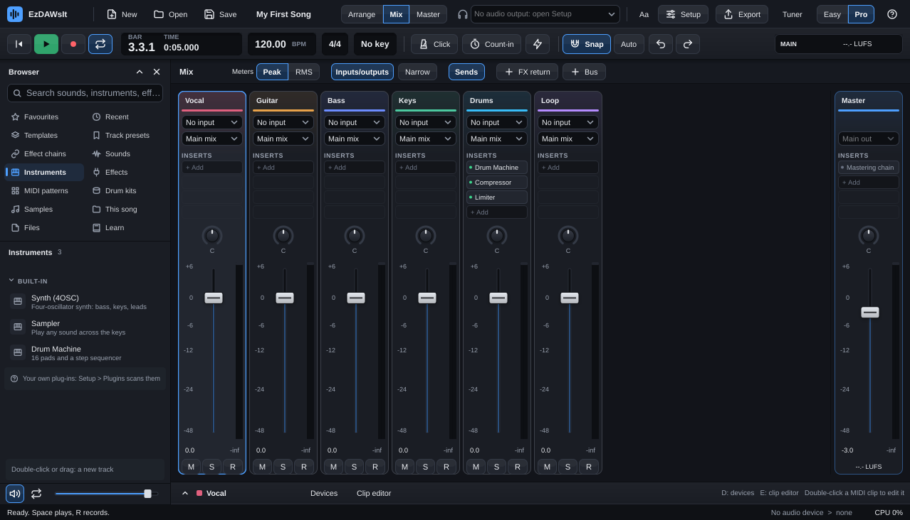
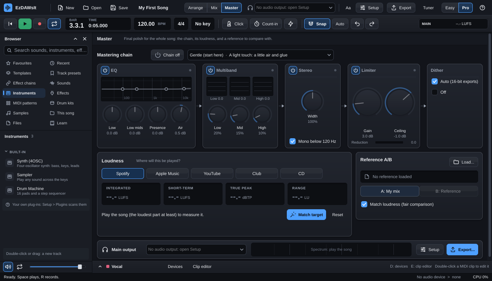
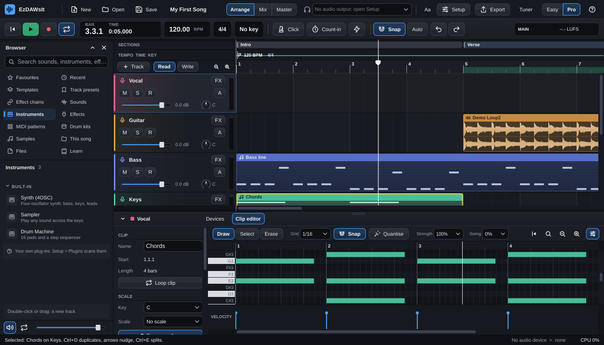
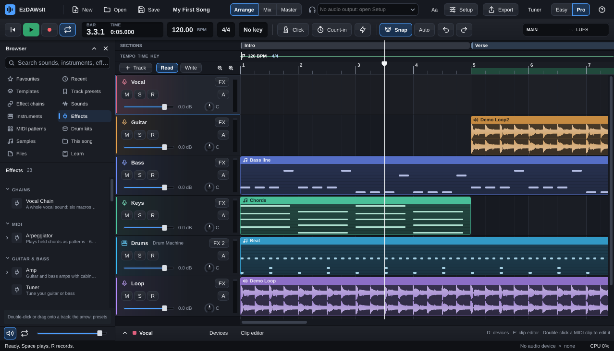
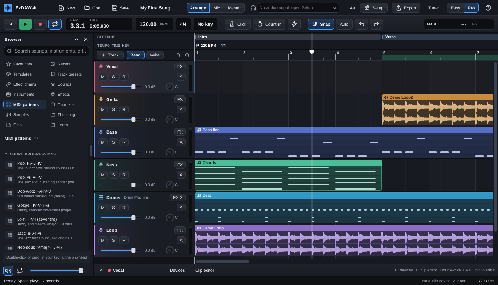
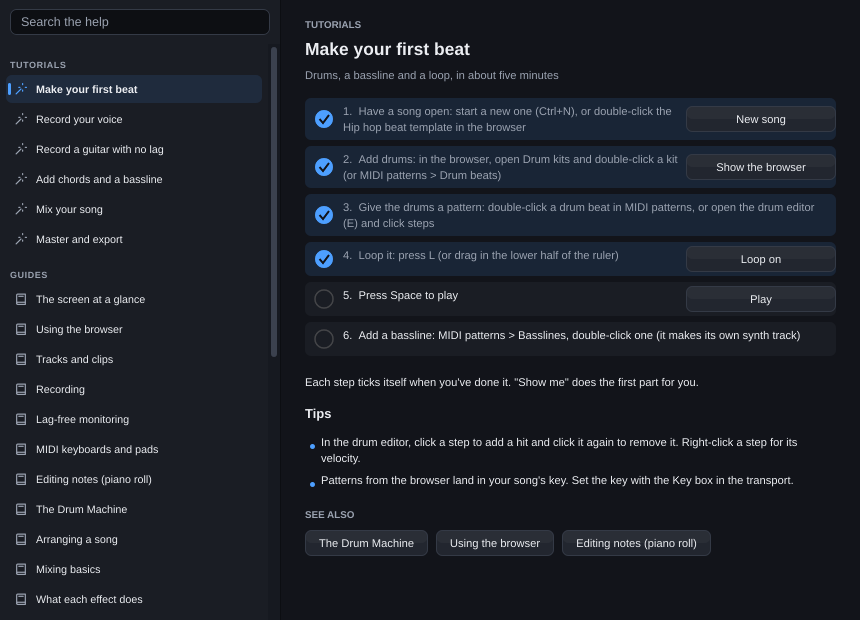

# EzDAWsIt

A powerful but easy DAW: record, arrange, mix and master in one app.

Windows 10/11 (64-bit). Published by EzDAW. Version 1.1.0.

| Mix | Master | Clip editor |
| --- | --- | --- |
|  |  |  |

| The browser | MIDI patterns in your key | Help guide and tutorials (F1) |
| --- | --- | --- |
|  |  |  |

## What's in it

- **Record**: audio and MIDI with count-in, punch, loop takes, a tuner, guitar and bass amps, and low-latency
  monitoring that switches off delaying effects while you play live (Ctrl+Alt+L).
- **Make music fast**: 57 MIDI patterns (chords, basslines, melodies, drum beats) that land in your song's key,
  34 synth sounds, 15 drum kits, a Drum Machine with a step sequencer, a sampler and an arpeggiator.
- **Start from something**: 23 song templates, 59 track presets, 30 effect chains and 112 effect presets.
- **Mix and master**: inserts, sends, returns, buses, automation, a mastering chain with loudness targets and a
  reference A/B, freeze and bounce, and VST3 hosting that a broken plugin can't crash.
- **The EzDAW plug-ins built in**: AETHER X1 Heritage (guitar amp, pedals and cab), StudioVoice Pro (vocal strip),
  and the instruments Aurelia 290, HexaFold, Voxalis, RIOT PRESS MK4 (bass), BASSED GOD (808 basslines) and HOT LAVA 90 (leads and melodies).
- **Learn as you go**: F1 opens tutorials whose steps tick themselves as you do them, guides and troubleshooting.

## Download

Get the installer from the [Releases page](https://github.com/Mendo-707/ezdawsit/releases/latest).
1.1.0 is a beta: please report problems on the [Issues page](https://github.com/Mendo-707/ezdawsit/issues),
with the log from **Help > Open the log folder**.

Windows may warn "Windows protected your PC" because the installer isn't code-signed yet:
click **More info**, then **Run anyway**.

## Install

Run `EzDAWsIt-Setup-<version>.exe`. It installs EzDAWsIt for everyone on the PC (or only you, without
administrator rights), adds Start menu and desktop shortcuts, and can open songs (`.tracktionedit`)
with a double-click. Uninstalling never deletes your songs.

## Build (Windows)

1. Double-click `build.bat`.
2. Wait for "SUCCESS" (the first build takes 15-30 minutes). It builds the app, then runs the self-tests.
3. EzDAWsIt starts. The app lives in `app\EzDAWsIt.exe`, and the installer in `dist\` (with the matching
   source package). The installer needs Inno Setup 6, which build.bat installs with winget if it is missing.

Needs Visual Studio 2022 with "Desktop development with C++", Git, and an internet connection for the first build.
Run the self-tests again any time with `test.bat` (results in `test-results.txt`).

## Basics

| Action | Button | Shortcut |
| --- | --- | --- |
| Play / stop | Play | Space |
| Record on armed tracks | Record | R |
| Back to start | \|< | Home |
| Metronome | Click | C |
| Save (also autosaves every minute) | Save | Ctrl+S |
| New song / open song | New Song / Open | Ctrl+N / Ctrl+O |
| Add a track / import audio | + Track / Import Audio | Ctrl+T / Ctrl+I |
| Undo / redo | Undo / Redo | Ctrl+Z / Ctrl+Y |

- **Setup > Audio device**: pick your audio interface. ASIO drivers give the lowest latency.
- On any track: **R** arms it for recording, **M** mutes, **S** solos, **FX** shows its effects, **A** its automation.
- The browser (**B**) has everything you can add: double-click to use it, drag it onto a track, star it (**Ctrl+K**). **Ctrl+F** searches it all.
- **F1** opens the help guide and tutorials. **Ctrl+/** lists every keyboard shortcut.
- Songs live in `Documents\EzDAWsIt\Projects`. If the app ever closes unexpectedly, it offers to restore your unsaved work next time.
- Logs (useful when reporting a problem) are in `Documents\EzDAWsIt\Logs`.

## For developers and AI agents

Read `AGENTS.md` (architecture, commands, rules). Mistakes and their fixes are logged in `docs/LESSONS.md`.

## Licence

EzDAWsIt is free software under the GNU General Public License v3 (`LICENSE.txt`).
It is built on [JUCE](https://juce.com) (used under AGPLv3) and [Tracktion Engine](https://github.com/Tracktion/tracktion_engine) (GPLv3),
with Steinberg's ASIO (GPLv3 option) and VST3 (MIT) SDKs. Every bundled component and its licence is listed in
`installer/THIRD-PARTY-NOTICES.txt`, which the installer puts next to the app (Help > About EzDAWsIt > Licences).

The installer also contains the eight EzDAW plug-ins (AETHER X1 Heritage, Aurelia 290, StudioVoice Pro, HexaFold, Voxalis,
RIOT PRESS MK4, BASSED GOD and HOT LAVA 90).
They are separate programs by the same author, installed beside the app in `Plugins\`; their source isn't part of this
repository. Their own notices (Voxalis uses the CMU Pronouncing Dictionary) are installed with them.
